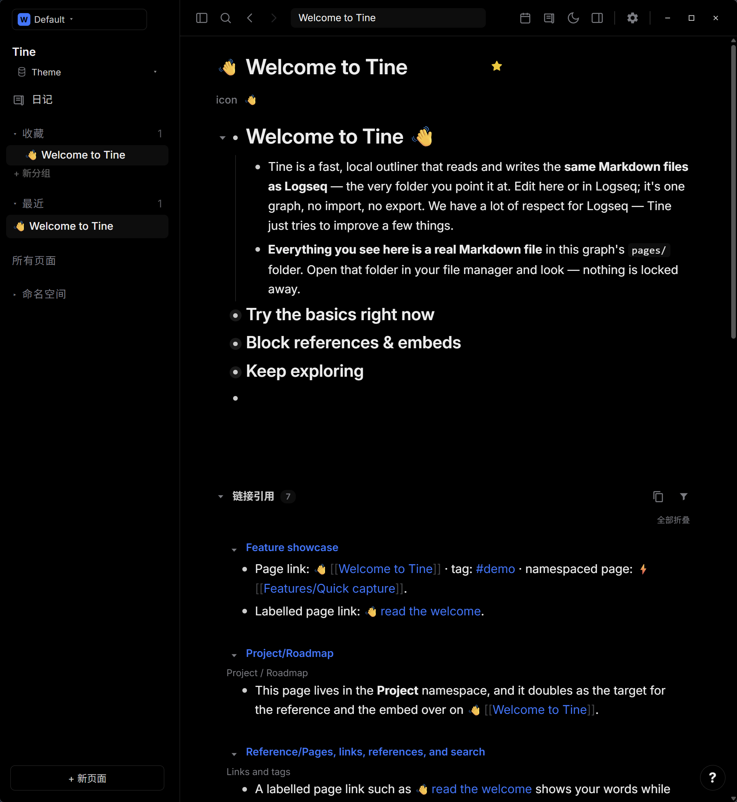
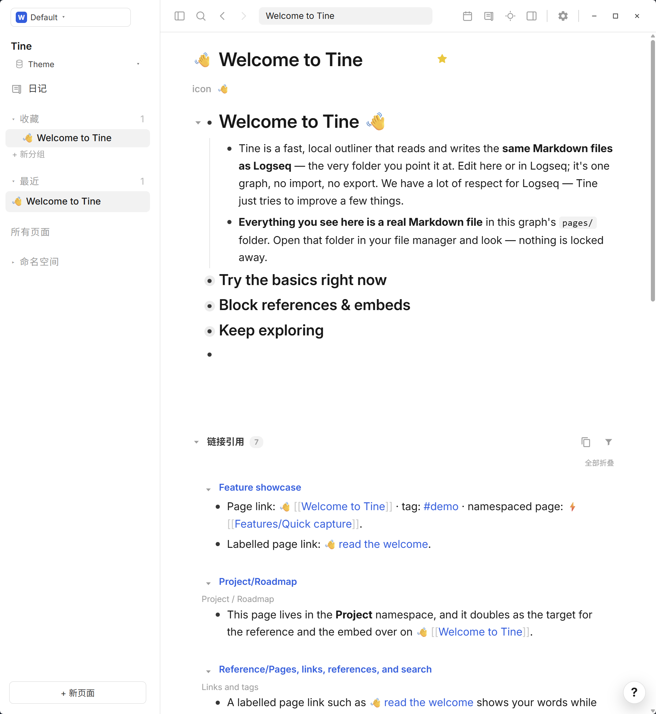

# Vercel · Prism

**A clear horizon in black and white, with a blue light beyond.**

[Download theme.json](https://github.com/EllisMorrow/tine-theme-vercel-prism/releases/latest/download/theme.json) · [中文说明](README.zh-CN.md) · [Adaptation notes](docs/adaptation.md)

Vercel · Prism pairs a light and a dark reading palette inspired by the Vercel preset, with independently adapted Tine surfaces, links and highlights.

Explore the full [Prism theme gallery](https://github.com/martinkoutecky/tine/discussions/786) to compare all 29 themes in light and dark modes.

### Dark mode

### Light mode

*Actual Windows Tine screenshots supplied after testing. Both palettes are included in this package.*

## Install

1. Download [theme.json](https://github.com/EllisMorrow/tine-theme-vercel-prism/releases/latest/download/theme.json).
2. In Tine, open **Settings → Appearance → Theme packages → Select theme.json** and select the downloaded file.
3. Choose **Use colors**, then select **Light**, **Dark** or **System** mode.

Requires Tine Theme API **0.2** support. Existing `logseq/custom.css` and device accent settings may affect the result. This package supplies colors only; typography, layout, task markers and other roles outside the theme API remain host-controlled.

## Palette

| Role | Light | Dark |
| --- | --- | --- |
| Canvas | `#ffffff` | `#000000` |
| Sidebar | `#ffffff` | `#000000` |
| Body | `#171717` | `#ededed` |
| Heading | `#171717` | `#ededed` |
| Accent | `#006aff` | `#006efe` |
| Links | `#005ee2` | `#0f76fe` |
| Tags | `#005ee2` | `#0f76fe` |
| Mark background | `#e0edff` | `#000d1e` |

## Tested in Tine

The manifest passed the official theme checker. A Chromium fixture checked both complete token sets, mode switching and specified contrast pairs. The user supplied the real Windows light/dark screenshots above using Tine's public welcome graph. The visible headings, body, outlines, links, tags, inline code and reference panels are shown; mark highlights, selection behavior, Settings and other platforms are not established by these images. See [screenshot notes](docs/screenshots.md).

## Source and scope

Visual reference: [Codex Vercel appearance preset](https://learn.chatgpt.com/docs/reference/settings#appearance), `installed version 26.1021.3705`. This independently authored mapping is licensed under MIT; see [LICENSE](LICENSE). Selected literal color values were read from the installed Codex preset definitions and independently mapped to Tine roles. No Codex source code or bundled assets are redistributed. An independently generated companion mode is documented where the reference has one mode; the original upstream source of this Codex preset has not been independently established.

Independent community adaptation by **EllisMorrow**, developed with AI assistance (`aiDevelopment: primary`). No Codex program code, logo or bundled assets are included. No affiliation or endorsement is claimed.

Only the 21 supported literal color roles per mode are packaged. It does not claim pixel-for-pixel reproduction of Codex, or that all Tine-derived and opacity-dimmed text meets a contrast target. Check results and actual application coverage are recorded in [adaptation notes](docs/adaptation.md).

## Feedback

[Open an issue](https://github.com/EllisMorrow/tine-theme-vercel-prism/issues) with your Tine version, operating system, mode and a screenshot without private note content. The download badge counts GitHub Release asset downloads, not installations or unique users.
